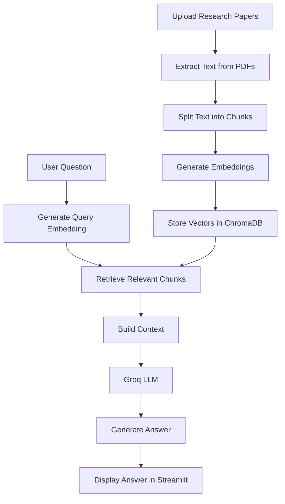

# Scientific Research Paper Analyser

**An AI-powered research assistant that lets you query scientific research papers and retrieve answers using Retrieval-Augmented Generation (RAG).**

The Scientific Research Paper Analyser simplifies the process of understanding research papers by allowing users to upload PDF documents and ask questions about their contents. It retrieves relevant information from the uploaded papers and uses a Large Language Model (LLM) to generate contextual answers.

Built using Python, Streamlit, Sentence Transformers, ChromaDB, and Groq, this project combines semantic search with generative AI to make scientific literature easier to explore.

---

## Features

* **PDF Document Processing:** Load and extract text from scientific research papers in PDF format.
* **Intelligent Text Chunking:** Split lengthy documents into smaller, overlapping chunks for efficient retrieval.
* **Semantic Search:** Generate vector embeddings to identify passages relevant to a user's query.
* **Vector Database:** Store and retrieve document embeddings using ChromaDB.
* **AI-Powered Question Answering:** Use a Groq-hosted LLM to generate answers based on retrieved document context.
* **Interactive Interface:** Upload research papers and ask questions through a Streamlit web application.
* **Persistent Vector Storage:** Retain document embeddings locally between application sessions.

## Tech Stack

| Technology                     | Purpose                                        |
| ------------------------------ | ---------------------------------------------- |
| Python                         | Core programming language                      |
| Streamlit                      | Interactive web interface                      |
| LangChain                      | PDF processing and text-splitting integrations |
| PyPDFLoader                    | Extract text from PDF documents                |
| RecursiveCharacterTextSplitter | Split documents into manageable chunks         |
| Sentence Transformers          | Generate semantic embeddings                   |
| `all-MiniLM-L6-v2`             | Text embedding model                           |
| ChromaDB                       | Persistent vector database                     |
| LangChain Groq                 | Integration with Groq-hosted language models   |
| `openai/gpt-oss-120b`          | Large Language Model for answer generation     |
| python-dotenv                  | Load environment variables securely            |

## How It Works

The application follows a Retrieval-Augmented Generation (RAG) pipeline.



### Pipeline Breakdown

**1. Document Ingestion**

Research papers are loaded from PDF files using `PyPDFLoader`, which extracts their textual content.

**2. Text Chunking**

The extracted text is divided into smaller chunks using `RecursiveCharacterTextSplitter`.

Current configuration:

* Chunk size: 500 characters
* Chunk overlap: 50 characters

Overlapping chunks help preserve context across chunk boundaries.

**3. Embedding Generation**

The `all-MiniLM-L6-v2` model converts text chunks into numerical vector representations that capture semantic meaning.

**4. Vector Storage**

The generated embeddings and associated document information are stored in a persistent ChromaDB collection named `pdf_documents`.

**5. Semantic Retrieval**

When a user submits a question, the system retrieves relevant document chunks using vector similarity search.

**6. Answer Generation**

The retrieved context is passed to a Groq-hosted LLM, which generates a response based on the available information.

**7. Interactive Results**

The generated answer is presented through the Streamlit interface.

## Project Structure

The application uses a modular Python structure. The following is the expected layout; adjust the filenames if your repository differs.

```text
research-paper-analyser/
│
├── app.py                  # Streamlit application entry point
├── rag.py                  # RAG pipeline and document processing
├── data/
│   ├── pdf/                # Input research papers
│   └── vector_store/       # Persistent ChromaDB storage
│
├── .env                    # Environment variables (not committed)
├── .gitignore
├── requirements.txt        # Python dependencies
└── README.md
```

## Getting Started

Follow these steps to run the project locally.

### Prerequisites

* Python 3.10 or a compatible version supported by your dependencies
* pip
* A Groq API key

### 1. Clone the Repository

```bash
git clone https://github.com/muskanmundra18-lab/research-paper-analyser.git
```

Navigate to the project directory:

```bash
cd research-paper-analyser
```

### 2. Create a Virtual Environment

```bash
python -m venv venv
```

Activate it.

**Windows:**

```bash
venv\Scripts\activate
```

**Linux/macOS:**

```bash
source venv/bin/activate
```

### 3. Install Dependencies

```bash
pip install -r requirements.txt
```

Otherwise, install the required packages:

```bash
pip install streamlit langchain-community langchain-text-splitters sentence-transformers chromadb python-dotenv langchain-groq pypdf
```

### 4. Configure Environment Variables

Create a `.env` file in the project root directory and add your Groq API key:

```env
Groq_API_KEY=your_groq_api_key
```

Replace `your_groq_api_key` with your actual API key.

**Security note:** Never commit your `.env` file or expose your API key in source code.

Ensure your application loads the environment variables using `python-dotenv`.

### 5. Prepare the Data Directory

Create the directory used to store research papers:

```text
data/
├── pdf/
└── vector_store/
```

Place your research paper PDFs inside `data/pdf/`.

The application should initialize the vector store if it does not already exist.

### 6. Run the Application


```bash
streamlit run app.py
```

Open the local URL displayed in your terminal to access the application.

## Usage

1. Launch the application.
2. Place your research paper PDFs in the configured input directory.
3. Allow the application to process the documents and generate embeddings.
4. Enter a question related to the uploaded research papers.
5. Submit the question.
6. Review the answer generated from the retrieved document context.

### Example Questions

You can use questions such as:

* What is the primary objective of this research paper?
* Which methodology does the paper propose?
* What datasets were used in the study?
* What are the key findings of the research?
* What limitations do the authors identify?
* How does the proposed approach compare with the existing methods discussed in the paper?

The quality of the answers depends on the information extracted from the PDFs and the relevance of the retrieved passages.

## Configuration

The current RAG pipeline uses the following configuration:

| Parameter         | Value                 |
| ----------------- | --------------------- |
| Embedding model   | `all-MiniLM-L6-v2`    |
| Chunk size        | 500 characters        |
| Chunk overlap     | 50 characters         |
| Vector database   | ChromaDB              |
| Collection name   | `pdf_documents`       |
| Vector store path | `data/vector_store`   |
| LLM provider      | Groq                  |
| LLM model         | `openai/gpt-oss-120b` |

These values can be adjusted in the relevant configuration or pipeline code.

## Key Concepts Demonstrated

This project demonstrates practical implementation of several AI engineering concepts:

* Retrieval-Augmented Generation (RAG)
* Text preprocessing and document chunking
* Dense vector embeddings
* Semantic similarity search
* Vector database management
* LLM-based question answering
* Integration of open-source embedding models with hosted LLMs
* Building AI applications with Streamlit

## Limitations

* **PDF extraction:** Scanned PDFs and documents with complex layouts may require OCR or specialized document parsers.
* **Context limitations:** Answer quality depends on the relevance and completeness of retrieved text chunks.
* **Hallucinations:** The language model may produce incorrect information if the retrieved context is insufficient.
* **Persistence management:** Reprocessing the same documents without deduplication can create duplicate entries in the vector database.
* **Source verification:** Answers should be checked against the original research papers, particularly for scientific claims and numerical results.
* **Document scope:** The system can only answer questions about information available in the documents it processes.

## Future Improvements

Potential enhancements include:

* **Source citations:** Display the PDF filename and page number supporting each answer.
* **Multi-document analysis:** Compare findings and methodologies across multiple research papers.
* **Hybrid retrieval:** Combine semantic search with keyword-based retrieval.
* **Reranking:** Improve retrieval quality by reranking candidate passages before generating answers.
* **Conversation history:** Support follow-up questions that depend on previous interactions.
* **Evaluation:** Measure retrieval relevance and answer quality using a dedicated RAG evaluation framework.
* **Improved document parsing:** Support tables, mathematical expressions, and scanned documents.
* **Evidence-aware responses:** Detect insufficient context and avoid generating unsupported answers.

## Contributing

Contributions, suggestions, and bug reports are welcome.

1. Fork the repository.
2. Create a feature branch.
3. Implement and test your changes.
4. Submit a pull request describing your improvements.

## Author

**Muskan Mundra**

* GitHub: [@muskanmundra18-lab](https://github.com/muskanmundra18-lab)
* Project Repository: [Research Paper Analyser](https://github.com/muskanmundra18-lab/research-paper-analyser)

---

*Built to make scientific literature more accessible through Retrieval-Augmented Generation and Large Language Models.*
